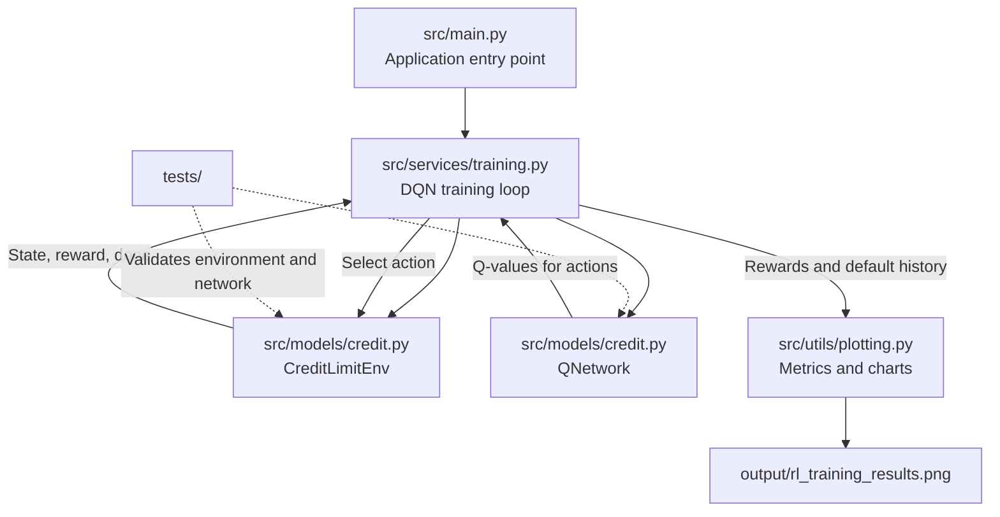

# Credit Limit Management with Deep Reinforcement Learning

A Deep Q-Network (DQN) agent that learns credit-limit management strategies in
a simulated customer environment. The simulation tracks credit utilization,
delinquency, and credit score over episodes of up to 12 steps.

## Architecture

The GitHub-rendered diagram below shows the main runtime flow. The agent
interacts with the simulated environment, learns from rewards, and sends
episode metrics to the plotting utility.



### Project structure

```text
.
├── output/                 # Generated training charts
├── src/
│   ├── main.py             # Application entry point
│   ├── models/
│   │   └── credit.py       # Simulated environment and Q-network
│   ├── services/
│   │   └── training.py     # DQN training loop
│   └── utils/
│       └── plotting.py     # Training metric visualization
├── tests/                  # Automated tests
├── .gitignore
├── requirements.txt
└── README.md
```

## Requirements

Python 3.9 or later. Install the dependencies with:

```bash
python -m pip install -r requirements.txt
```

## Run the training

From the repository root, run:

```bash
python -m src.main
```

The training run displays a chart and saves it to
`output/rl_training_results.png`. The `output/` directory is created
automatically when needed.

## Run the tests

```bash
python -m pytest
```
